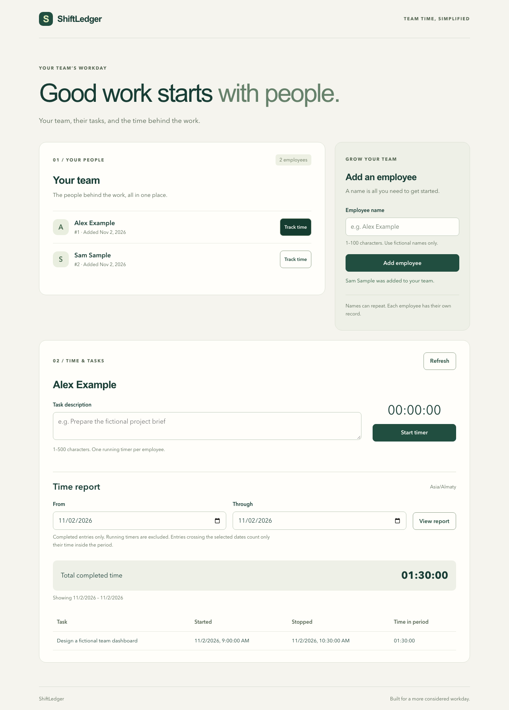

# ShiftLedger

A small employee time tracker built for the Falcon AI programmer assignment using **OpenAI Codex and GPT-6 Astra**. Add fictional employees, track tasks, and review completed time for any date range. No accounts or external services are required.



## Run

Requires **Node.js 24.2+ within the 24.x series** and **npm 11.x**. With nvm, run `nvm install` and `nvm use` to select `.nvmrc`.

```bash
git clone https://github.com/dias-btt/falconai-test.git
cd falconai-test
npm ci
npm run dev
```

Open [the app](http://127.0.0.1:5173). Add an employee, choose **Track time**, enter a task, and press **Start timer**. Stop the timer to include it in the report. Select inclusive **From** and **Through** dates and press **View report**.

The server automatically creates `data/shiftledger.sqlite` and applies migrations. Data survives page reloads, server restarts, and rebuilds. Optional fictional examples:

```bash
npm run db:seed
```

This adds Alex Example, Sam Sample, and Jordan Demo. Repeating it does not duplicate samples or change existing records. No real employee data is included in the repository.

### Production

Stop development first, then:

```bash
npm run build
npm start
```

Open [the production app](http://127.0.0.1:3001). One Node process serves the built React client and API. Retain `dist/`, `package.json`, production dependencies, and the database. Do not store the database inside `dist/`.

### Configuration

Defaults work without an environment file. Copy `.env.example` to `.env` to customize them, then restart the app.

| Variable | Default | Meaning |
| --- | --- | --- |
| `HOST` | `127.0.0.1` | API/production bind address |
| `PORT` | `3001` | API/production port; Vite's proxy reads it too |
| `DATABASE_PATH` | `./data/shiftledger.sqlite` | Absolute path or path relative to the working directory |

Use the default host for local development. The app intentionally has no authentication; use fictional data and local access. Node 24.2 emits an experimental warning for its built-in SQLite module; no flag or separate database installation is needed.

## Verification

```bash
npx playwright install chromium
npm run verify
```

On Linux, use `npx playwright install --with-deps chromium` if browser system libraries are missing. `verify` runs lint, type checking, API/database tests, the production build, and browser acceptance tests. Browsers are needed only for acceptance tests, not to run the app.

| Command | Purpose |
| --- | --- |
| `npm run check` | Lint, unit/integration tests, type checking, build |
| `npm test` | Unit and API/database tests |
| `npm run test:watch` | Watch those tests during development |
| `npm run test:e2e` | Browser tests against the existing production build |
| `npm run build` | Type check and compile client/server |
| `npm run lint` / `npm run typecheck` | Individual static checks |

Acceptance tests start isolated API processes with disposable SQLite databases and exercise Chromium desktop and mobile layouts. They cover creating employees, timer reload/start–stop–start, completed history, employee/date filters, empty reports, failed saves, and recovery after a lost start response. Axe checks the rendered UI for selected WCAG A/AA rules. API tests additionally cover a **real server restart**, concurrent starts, idempotent stops, boundary clipping, and daylight-saving changes. Automated accessibility checks do not replace a full accessibility audit.

[CI](https://github.com/dias-btt/falconai-test/actions/workflows/ci.yml) runs on PRs and pushes to `main`, testing the minimum and current Node 24 releases and the browser suite. [Validation evidence](docs/VALIDATION.md) records the checks actually run and their limits.

## Design decisions

- **Small stack:** React/Vite + strict TypeScript, Express, and Node's built-in SQLite. No ORM, remote database, AI API key, or cloud service is needed to run it.
- **Durable timers:** the server supplies UTC millisecond timestamps. SQLite holds the start time until explicitly stopped, so downtime counts toward a running timer. A database index and atomic insert enforce one active timer per employee. Repeated stops keep their original timestamp; restarting creates a new entry.
- **Clear reports:** inclusive local calendar dates become the UTC interval `[from, to)`. Completed records contribute only their overlap with that interval. Active timers appear separately and do not inflate completed totals. Calculations retain milliseconds; display uses `HH:MM:SS`, including totals above 24 hours.
- **Validation and recovery:** names accept 1–100 characters and tasks 1–500 after trimming. Duplicate names are allowed and identified by separate records. Failed writes do not automatically retry; refresh confirms server state first. The UI discards obsolete employee/report responses.
- **Testable boundaries:** HTTP construction is separate from process startup; tests inject a database and clock. Migrations are transactional and reject unsupported future schemas without replacing data.

```text
src/client/         React interface and API clients
src/server/         HTTP routes, SQLite migrations, startup, seed command
src/shared/         Validation, API types, calendar and duration helpers
tests/              Unit, API, persistence, and process-restart tests
tests/e2e/          Isolated browser fixtures and acceptance tests
docs/               Work log, plan, validation record, screenshots
.github/            CI and PR template
```

| API | Result |
| --- | --- |
| `GET /api/employees` | Employee list |
| `POST /api/employees` with `{ "name": "Alex Example" }` | New employee, HTTP 201 |
| `GET /api/employees/:id/timer` | Active entry or null, plus server time |
| `POST /api/employees/:id/timer/start` with `{ "description": "Fictional task" }` | Running entry, HTTP 201; already running is 409 |
| `POST /api/time-entries/:id/stop` | Stopped entry; safe to repeat |
| `GET /api/employees/:id/report?from=...&to=...` | Completed records, `durationMs`, `totalMs`; UTC millisecond bounds |

## AI use and human review

**Tool:** OpenAI Codex desktop. **Model:** GPT-6 Astra, confirmed by the author from the chat's model selection. AI produced planning, implementation, tests, and documentation. The author supplied the requirements, chose the staged workflow, and committed and merged the work through GitHub PRs. No AI integration is embedded in the application.

Actual request excerpts from the development chat:

1. “Create from scratch a small web application for tracking employees' working time in a company.” The supplied assignment also required persistence, timer-restart tests, and an empty report.
2. “it should be strong, with clear work shown on github (PR, branches, commits etc) … you write me a plan, execute first step” — established the incremental delivery plan.
3. “do steps 4 and 5 together. tokens are limited, so make sure you dont waste them on unnecessary checks” — combined timers and reporting with focused verification.
4. “now do 6 and 7 step” — added acceptance coverage and prepared the submission.

The [AI work log](docs/AI_WORK_LOG.md) distinguishes actual requests, proposed example prompts, generated changes, failures, and verification. Generated code was checked with automated tests, type checking, lint, and browser inspection rather than accepted solely because it ran once.

**Confirmed errors found and fixed:**

- **HTTP status:** the first error handler changed oversized JSON requests into HTTP 500. A regression test reproduced `expected 413, got 500`; handling the parser's `entity.too.large` error now returns HTTP 413. The test remains in `tests/app.test.ts`.
- **Contrast:** browser acceptance found muted text and the selected employee hover state below contrast requirements. Darkened the text and fixed the selected hover style.
- **Keyboard access:** the overflowing mobile report table could not receive keyboard focus. Added a labeled focusable region and visible focus ring.

The latter two fixes are covered by browser accessibility/focus checks. [Validation evidence](docs/VALIDATION.md) records the initial failures and successful reruns. Test-code lint/type errors were recorded separately from application defects.

## GitHub delivery history

| PR | Scope |
| --- | --- |
| [#1](https://github.com/dias-btt/falconai-test/pull/1) | TypeScript foundation, SQLite schema, tests, CI |
| [#2](https://github.com/dias-btt/falconai-test/pull/2) | Employee creation, validation, persistence, seed data |
| [#3](https://github.com/dias-btt/falconai-test/pull/3) | Timers, reports, restart and date-boundary tests |

Acceptance and submission work is on `feat/submission` until its final PR is merged. See [CONTRIBUTING.md](CONTRIBUTING.md) and the [delivery plan](docs/IMPLEMENTATION_PLAN.md). The public repository is the required deliverable; a hosted demo is optional and is not provided.

## Limits

- Explicit **Refresh** synchronizes changes from another browser; there is no polling, authentication, employee editing/deletion, payroll, or export.
- SQLite and its synchronous driver suit this small local application; this is not a multi-instance hosted deployment design.
- Browser automation covers Chromium desktop/mobile, not all browser engines.
- The latest recorded production dependency audit has zero findings. The development lint toolchain still has the documented [minimatch advisory](https://github.com/advisories/GHSA-g3hv-75wg-m249); see the validation record. No forced incompatible dependency override has been applied.
